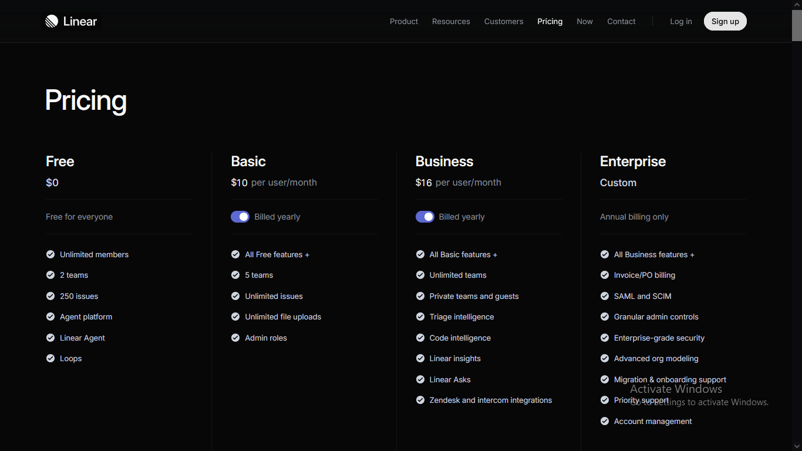
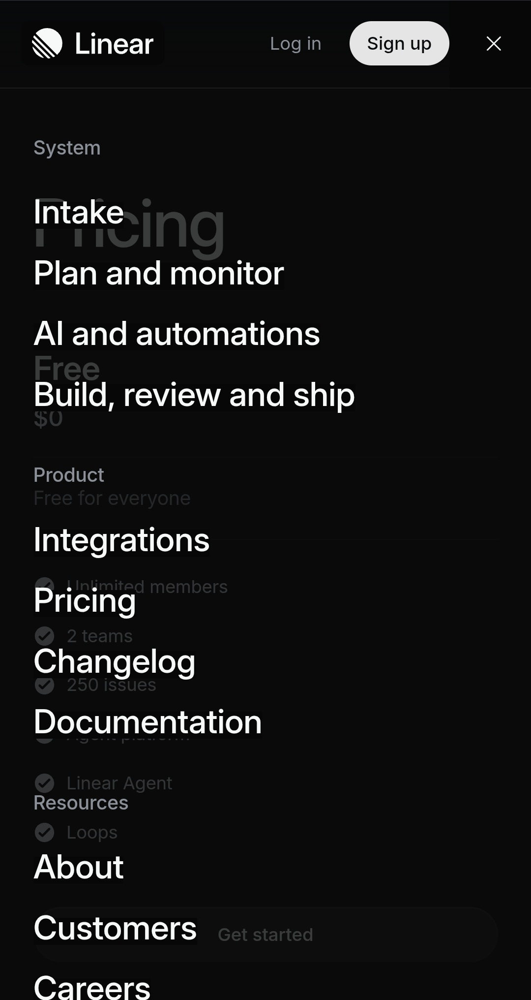

# Linear-Inspired SaaS Pricing & Navigation UI

A high-converting, mobile-first SaaS pricing matrix and responsive navigation system inspired by Linear's dark-mode aesthetic.

## Overview

This project solves common mobile user drop-off issues—such as overlapping navigation headers and unreadable multi-column pricing tables—through a structured, adaptive dark-mode web interface.

## Project Status

Completed — Client-ready UI component showcase.

## Built With

- HTML5
- CSS3 (CSS Grid, Flexbox, Media Queries)
- Google Fonts

## Features

- Adaptive 4-column SaaS pricing matrix that stacks cleanly on mobile
- Thumb-friendly responsive navigation drawer
- Visual hierarchy highlighting the primary recommended plan
- Subtle pure-CSS hover lift and glow micro-interactions
- Zero-bloat semantic structure for fast load speeds
- Overflow-free layout across mobile, tablet, and desktop screens

## Project Purpose

Created to demonstrate how clean frontend architecture eliminates mobile bounce rates, clarifies complex pricing tiers for buyers, and delivers a premium software brand experience without heavy frameworks.

## Screenshots

  

## Interactive Demo & Animations

_Showcasing the responsive mobile navigation menu toggle and the continuous infinite logo marquee animation at the bottom of the page._

https://github.com/user-attachments/assets/401a34eb-e562-48cc-bf28-edad2a366117

## Live Demo

[View Live Website](https://shezan-ali.github.io/pricing-linear/)

## What This Project Demonstrates

- Solving mobile layout breaking and horizontal scroll issues using CSS Grid and Media Queries.
- Guiding user conversion through clear visual hierarchy and contrast elevation.
- Building responsive navigation systems that adapt smoothly from desktop headers to mobile drawers.
- Writing lightweight, maintainable HTML5 and CSS3 for fast page performance.
- Translating modern dark-mode SaaS design systems into production-ready code.

## Disclaimer

This is an independent frontend project inspired by Linear's visual design system and is not affiliated with or endorsed by Linear.
